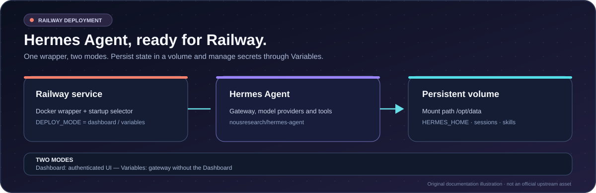
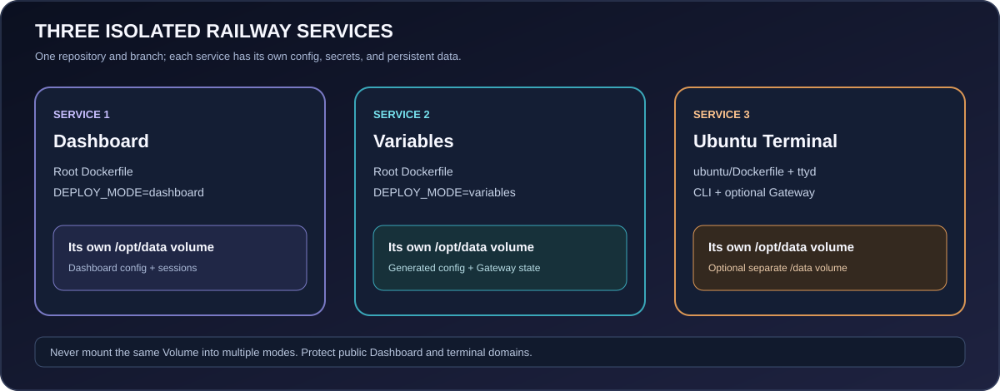

<div align="center">


<h1>Hermes Agent Railway</h1>

<p><a href="https://github.com/DURIAN-ORGANISASI/hermes-railway/actions/workflows/validate.yml"></a> <a href="LICENSE"></a>  </p>

<p><a href="README.md">🇮🇩 Bahasa Indonesia</a> · <a href="README.en.md">🇬🇧 English</a></p>

<p><strong>Run Hermes Agent on Railway.</strong><br>
Three modes are available: Dashboard, Railway Variables, and Ubuntu Terminal.</p>

<p><a href="#features">Features</a> · <a href="#choose-a-mode">Deployment modes</a> · <a href="#deploy-to-railway">Deploy</a> · <a href="#dashboard-security">Security</a> · <a href="#sources-attribution-and-licensing">Sources &amp; license</a></p>

</div>


<p align="center"><sub>Original documentation illustration — not an official Hermes Agent or Railway asset or screenshot.</sub></p>

<p align="center"><sub>The validation badge means the workflow is configured; it does not show live pass/fail status. Open <a href="https://github.com/DURIAN-ORGANISASI/hermes-railway/actions">Actions</a> for the latest run.</sub></p>

> [!WARNING]
> **Dashboard on a public domain:** Dashboard mode uses basic username/password authentication. Official Hermes documentation recommends this only for a trusted network or VPN, not direct public-internet exposure. Railway public domains are internet-accessible. Configure OAuth/OIDC or a trusted access gateway before exposing the Dashboard; this repository does not configure OAuth/OIDC automatically. See [Dashboard security](#dashboard-security).

## Overview

This repository provides three deployment modes that can run concurrently as three separate Railway services. Dashboard and Variables use the upstream Hermes image; Ubuntu uses a dedicated Ubuntu Dockerfile at `ubuntu/Dockerfile`.

| Mode | Purpose | Main variables |
| --- | --- | --- |
| **Dashboard** | Web interface for managing Hermes. | `USERNAME`, `PASSWORD`, `SECRET` |
| **Railway Variables** | Telegram/Discord gateway without a web Dashboard. | At least one provider API key; optional chat tokens |
| **Ubuntu Terminal** | Browser-based Ubuntu 26.04 terminal, Hermes CLI, optional Gateway. | `TERMINAL_USER`, `TERMINAL_PASSWORD`, `HERMES_AUTOSTART` |

> [!IMPORTANT]
> **Each bot token should belong to only one service.** Dashboard and Variables both run a Gateway; Ubuntu can also run one when `HERMES_AUTOSTART=true`. Do not copy the same Telegram/Discord token to multiple services. Assign each bot to one service, or use different bot tokens, so multiple Gateways do not compete for the same updates/events.

## Features

- **Three deployment modes:** Dashboard and Variables are selected with `DEPLOY_MODE`; Ubuntu uses a separate Dockerfile selected through `RAILWAY_DOCKERFILE_PATH` so its OS base and terminal features do not alter the upstream Hermes image.
- **Separated state:** each service has its own Railway Volume mounted at `/opt/data`; never reuse or share a volume between services.
- **Automatic model selection:** Variables mode prioritizes Groq → Mistral → NVIDIA → Gemini and configures later active providers as fallbacks.
- **Chat integrations:** Telegram/Discord with user and channel allowlists for the configured mode.
- **Ubuntu Terminal:** retains `ttyd`, terminal authentication, system banner, Git/Python, and optional Gateway; terminal files can be persisted separately at `/data`.
- **Maintained docs:** sources, license scope, security policy, examples, and static CI checks.

## Choose a mode

### 1. Dashboard

This is the default when `DEPLOY_MODE` is unset. Add under **Railway → Dashboard service → Variables**:

    DEPLOY_MODE=dashboard
    USERNAME=admin
    PASSWORD=replace-with-a-strong-unique-password
    SECRET=replace-with-a-random-secret-at-least-32-characters-long

- Use a unique password and random `SECRET` at least 32 characters long; for example, generate one with `openssl rand -base64 32`.
- Add a Railway Volume mounted at `/opt/data`.
- The script uses `PORT` if provided; otherwise Dashboard uses port `9119`. The Railway target port must match.
- After securing access, configure providers/models and chat integrations using the official Hermes docs.

> [!IMPORTANT]
> Basic username/password is not a substitute for OAuth/OIDC on an internet-facing Dashboard. For a public domain, use OAuth/OIDC or a properly configured access gateway that restricts access.

### 2. Railway Variables

This mode does not start the Dashboard. Set variables under **Railway → Variables service → Variables**. At least one provider API key is required; other providers may be empty or omitted.

    DEPLOY_MODE=variables
    GROQ_API_KEY=
    MISTRAL_API_KEY=
    NVIDIA_API_KEY=
    GEMINI_API_KEY=
    GOOGLE_API_KEY=
    TELEGRAM_BOT_TOKEN=
    TELEGRAM_ALLOWED_USERS=
    DISCORD_BOT_TOKEN=
    DISCORD_ALLOWED_USERS=
    DISCORD_ALLOWED_CHANNELS=
    DISCORD_FREE_RESPONSE_CHANNELS=
    DISCORD_AUTO_THREAD=false

Minimal NVIDIA-only setup:

    DEPLOY_MODE=variables
    NVIDIA_API_KEY=your_nvidia_api_key

`GOOGLE_API_KEY` is accepted as a Gemini alias when `GEMINI_API_KEY` is empty.

#### Provider order and startup models

| Priority | Variable | Default startup model |
| ---: | --- | --- |
| 1 | `GROQ_API_KEY` | `openai/gpt-oss-20b` |
| 2 | `MISTRAL_API_KEY` | `ministral-3b-latest` |
| 3 | `NVIDIA_API_KEY` | `nvidia/nemotron-3.5-super-vl-120b-a12b` |
| 4 | `GEMINI_API_KEY` / `GOOGLE_API_KEY` | `gemini-3.8-flash` |

Default model IDs were reviewed against provider documentation on October 18, 2026. Pricing, quotas, and availability can change; verify model access in your provider account before deploying. Fallbacks only apply to failure types supported by Hermes/provider; not every quota or authentication error will be rerouted.

> [!NOTE]
> Variables mode regenerates `/opt/data/config.yaml` at startup from active API keys. Treat Railway Variables as the source of truth rather than manually editing the generated file.

#### Telegram and Discord variables

| Variable | Purpose |
| --- | --- |
| `TELEGRAM_BOT_TOKEN` | Bot token from [BotFather](https://core.telegram.org/bots#botfather). |
| `TELEGRAM_ALLOWED_USERS` | Allowed Telegram user IDs; follow the format supported by your Hermes version. |
| `DISCORD_BOT_TOKEN` | Official Discord application bot token, not a personal user token. |
| `DISCORD_ALLOWED_USERS` | Allowed Discord user IDs. |
| `DISCORD_ALLOWED_CHANNELS` | Allowed Discord channel IDs. |
| `DISCORD_FREE_RESPONSE_CHANNELS` | Channels where the bot may reply without a mention. |
| `DISCORD_AUTO_THREAD` | Set to `false` to disable automatic threads. |

Enable **Message Content Intent** in Discord Developer Portal only if required. Restrict users/channels and grant minimum permissions. Do not use a self-bot.

### 3. Ubuntu Terminal

This mode provides Ubuntu 26.04 with the `ttyd` browser terminal, system banner, Git/Python, Hermes CLI, and an optional Gateway. It is **not** the Hermes web Dashboard and does not use Variables mode's config regeneration wrapper.

Set these under **Railway → Ubuntu service → Variables**:

    TERMINAL_USER=durianadmin
    TERMINAL_PASSWORD=unique-password-at-least-16-characters
    HERMES_AUTOSTART=true
    TZ=Asia/Jakarta

- On the Ubuntu service, set the service-scoped variable `RAILWAY_DOCKERFILE_PATH=/ubuntu/Dockerfile`. Leave Root Directory empty so the build context stays at repository root, and set the restart policy to `On Failure` with up to 10 retries.
- Attach a dedicated Volume at `/opt/data` for Hermes config, sessions, memory, and logs. Attach a second, separate Volume at `/data` if terminal-created files must persist.
- After logging into the terminal, run `hermes setup` and `hermes gateway setup` for your chosen provider and chat channels. Once `/opt/data/config.yaml` exists, `HERMES_AUTOSTART=true` (the default) starts the Gateway automatically; set it to `false` to disable auto-start.
- Auto-start and the `start-hermes` wrapper share a lock at `/opt/data/.gateway.lock`, so the wrapper refuses to start a second Gateway. For manual startup, set `HERMES_AUTOSTART=false` and restart the service before running `start-hermes`. Avoid running `hermes gateway run` directly while auto-start is enabled because that bypasses the wrapper lock.
- The terminal domain exposes an Ubuntu shell running as root inside the container. Use a strong password, restrict access to the domain, and never commit secrets to GitHub.

> [!NOTE]
> Railway has deprecated Config-as-Code (`railway.json`/`railway.toml`) for new services and says existing files stop being read on December 1, 2026. The root file is retained for compatibility with existing services; configure build and restart policies in Railway Settings for new services. See [Railway documentation](https://docs.railway.com/config-as-code).

## Deploy to Railway

To run all three modes **at the same time**, create three Railway services connected to the same repository and branch. Leave **Root Directory** empty (repository root). Do not try to run all three modes in one service.

1. **Dashboard:** use the root Dockerfile and set the builder/path in Railway Settings for a new service. Set the restart policy to `On Failure` with up to 10 retries. Set `DEPLOY_MODE=dashboard`, `USERNAME`, `PASSWORD`, and `SECRET`.
2. **Variables:** use the root Dockerfile and set the builder/path in Railway Settings for a new service. Set the restart policy to `On Failure` with up to 10 retries. Set `DEPLOY_MODE=variables`, plus only the provider API keys and Telegram/Discord tokens needed.
3. **Ubuntu:** set `RAILWAY_DOCKERFILE_PATH=/ubuntu/Dockerfile` in that service's Variables. This selects the Ubuntu 26.04 image without changing the build context. Leave Root Directory empty because the Dockerfile copies `ubuntu/...` from the repository root.
4. **Separate storage:** create a different Railway Volume for each service and mount each one at `/opt/data`. Do not share a volume between services. On Ubuntu, attach another distinct Volume at `/data` if terminal-created files should survive redeploys.
5. **Separate secrets:** set variables at service scope, not as environment-wide shared variables. Keep Dashboard credentials on Dashboard only; provider/chat keys only on services that need them; keep `TERMINAL_USER` and `TERMINAL_PASSWORD` on Ubuntu only.
6. **Networking:** Variables mode generally needs no public domain. Expose Dashboard only behind OAuth/OIDC or a trusted access gateway. Ubuntu needs a domain for its browser terminal; the shell runs as root inside its container, so use a strong unique password.
7. Deploy each service manually when ready, inspect Deploy Logs, and test that service. Repository changes do not deploy anything to Railway.


## Watch Paths to reduce unrelated redeploys

Configure Watch Paths in **each Railway service's Settings**; a single shared `railway.json` cannot define a different path list for each service. Leave Root Directory empty. Use these patterns:

**Dashboard service**
```text
/Dockerfile
/railway-entrypoint.sh
/dashboard-entrypoint.sh
/railway.json
```

**Variables service**
```text
/Dockerfile
/railway-entrypoint.sh
/variables/**
/railway.json
```

**Ubuntu service**
```text
/ubuntu/**
/railway.json
```

Railway uses gitignore-style patterns. `railway.json` is intentionally included for all three services because its root configuration can affect each one. Documentation-only changes do not need to rebuild containers. If you add a root-level file used during a build, add its path to the relevant service's Watch Paths. See [Railway Watch Paths documentation](https://docs.railway.com/builds/build-configuration#configure-watch-paths).

## Architecture and repository layout



| Path | Purpose |
| --- | --- |
| `Dockerfile`, `railway.json` | Image build and Railway configuration. |
| `railway-entrypoint.sh` | Selects the startup mode. |
| `dashboard-entrypoint.sh` | Validates credentials and starts Dashboard. |
| `variables/railway-entrypoint.sh` | Generates provider/fallback configuration. |
| `ubuntu/Dockerfile`, `ubuntu/entrypoint.sh` | Ubuntu Terminal image/startup, including `ttyd` and optional Gateway. |
| `RAILWAY_DOCKERFILE_PATH` | Selects `ubuntu/Dockerfile` for the Ubuntu service only. |
| `ubuntu/README.md` | Ubuntu service and persistent-volume instructions. |
| `env-examples/` | Variable examples without active credentials. |
| `docs/SOURCES.md` | Upstream references, artwork attribution, and license scope. |
| `CONTRIBUTING.md`, `SECURITY.md` | Contribution and security guidance. |
| `scripts/` | Static configuration, documentation, and shell checks. |

## Dashboard security

- **Do not expose the Dashboard directly to the internet using only a shared password.** Upstream recommends basic authentication only on trusted networks/VPNs. Use OAuth/OIDC or a properly configured access gateway for public access.
- Dashboard is an administrative interface for sensitive configuration and agent actions.
- Keep passwords, API keys, bot tokens, and `SECRET` in Railway Variables—not in code, README files, screenshots, or public logs.
- `SECRET` signs sessions. Use a strong random value and keep it stable across redeploys; rotate it if compromised.
- Ensure the `/opt/data` Volume is mounted, restrict access to Variables, and back up important data.
- The Dockerfile uses upstream `latest`. Rebuilds may pull a different version; pin a tested version or digest for reproducible production deployments.
- Monitor provider API costs and bot permissions.

## Troubleshooting

| Problem | Check |
| --- | --- |
| Container exits at startup | Inspect Deploy Logs and `DEPLOY_MODE`. |
| Dashboard will not open | Check `USERNAME`, `PASSWORD`, `SECRET` (at least 32 characters), and target port. |
| Dashboard login fails | Check credentials and keep `SECRET` stable across redeploys. |
| Variables mode fails at startup | Set at least one Groq, Mistral, NVIDIA, or Gemini/Google API key. |
| Model unavailable | Check model ID, quota/balance, provider status, and account permissions. |
| Telegram does not respond | Check BotFather token, allowed IDs, and gateway logs. |
| Discord does not respond | Check bot token, permissions, Message Content Intent if required, and allowlists. |
| Data disappears after redeploy | Ensure the Volume is mounted at `/opt/data` on the correct service/environment. |

## Development and validation

    python scripts/validate_repo.py
    python scripts/check_docs.py
    python -m json.tool railway.json
    sh -n railway-entrypoint.sh
    sh -n dashboard-entrypoint.sh
    sh -n variables/railway-entrypoint.sh
    bash -n ubuntu/entrypoint.sh
    bash -n ubuntu/start-hermes
    bash -n ubuntu/system-banner.sh

CI checks configuration, local links, SVGs, JSON, and shell syntax. It does not test a live Docker image, Railway deployment, provider account, or message delivery.

## Sources, attribution, and licensing

See [`docs/SOURCES.md`](docs/SOURCES.md) for official references, artwork attribution, and license boundaries.

- **Repository license:** [MIT](LICENSE) applies to covered project-owned material, including the wrapper and documentation created here.
- **Hermes Agent upstream:** upstream source and image have their own license; the upstream repository currently includes an MIT License. This does not automatically relicense dependencies, API services, or trademarks.
- **Third parties:** Railway, Docker, Telegram, Discord, and model providers retain their own terms.

This independent project is not officially affiliated with or endorsed by Nous Research, Railway, Telegram, Discord, Groq, Mistral, NVIDIA, or Google.

## Contributing

Bug reports and pull requests are welcome. Read [`CONTRIBUTING.md`](CONTRIBUTING.md). Never include active tokens, environment files, API keys, or personal data in issues or commits.
