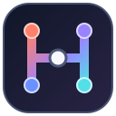
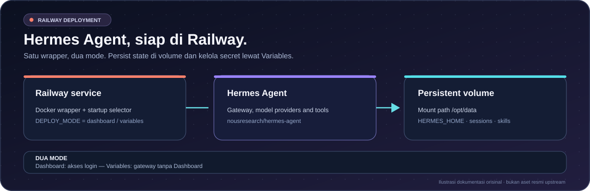
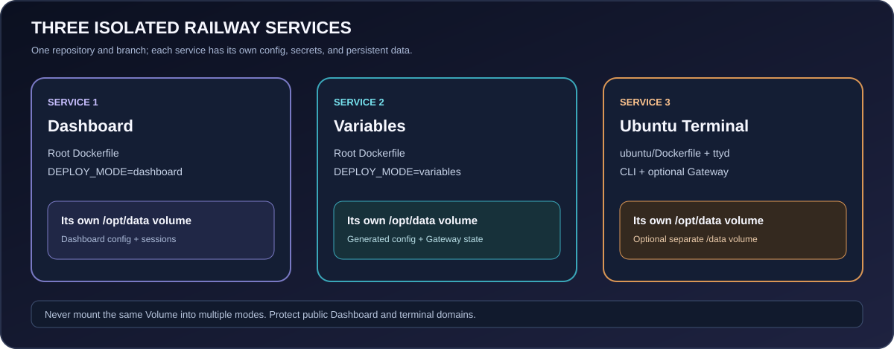

<h1>Hermes Agent Railway</h1>

   

<a href="README.md">🇮🇩 Bahasa Indonesia</a> · <a href="README.en.md">🇬🇧 English</a>

<strong>Jalankan Hermes Agent di Railway dengan dua mode: Dashboard atau Railway Variables.</strong>

<a href="#fitur">Fitur</a> · <a href="#pilih-mode">Mode deployment</a> · <a href="#deploy-ke-railway">Deploy</a> · <a href="#keamanan-dashboard">Keamanan</a> · <a href="#sumber-atribusi-dan-lisensi">Sumber &amp; lisensi</a>

Badge validation menandakan workflow tersedia, bukan status lulus/gagal secara langsung. Buka <a href="https://github.com/DURIAN-ORGANISASI/hermes-railway/actions">Actions</a> untuk hasil terbaru.

Ilustrasi orisinal untuk dokumentasi — bukan aset atau screenshot resmi Hermes Agent/Railway.

> [!WARNING]
> **Dashboard di domain publik:** mode Dashboard memakai autentikasi username/password dasar. Dokumentasi resmi Hermes menyarankan metode ini hanya untuk jaringan tepercaya atau VPN, bukan untuk mengekspos Dashboard langsung ke internet. Railway public domain dapat diakses dari internet. Sebelum membuka Dashboard secara publik, konfigurasikan OAuth/OIDC atau access gateway tepercaya. Repo ini tidak mengatur OAuth/OIDC secara otomatis. Baca [Keamanan Dashboard](#keamanan-dashboard).

## Ringkasan

Repository ini membungkus image upstream `nousresearch/hermes-agent` dengan startup wrapper untuk dua mode. Pilih satu mode per Railway service.

| Mode | Tujuan | Variabel utama |
| --- | --- | --- |
| **Dashboard** | Antarmuka web untuk mengelola Hermes. | `USERNAME`, `PASSWORD`, `SECRET` |
| **Railway Variables** | Gateway Telegram/Discord tanpa Dashboard web. | Minimal satu API key provider; token chat opsional |

## Fitur

- **Satu wrapper, dua mode:** `DEPLOY_MODE` memilih mode ketika startup.
- **State persisten:** Railway Volume di `/opt/data` menyimpan konfigurasi, sesi, skills, dan data Hermes.
- **Pemilihan model otomatis:** mode Variables memprioritaskan Groq → Mistral → NVIDIA → Gemini; provider aktif selanjutnya dikonfigurasi sebagai fallback.
- **Integrasi chat:** Telegram/Discord dengan allowlist pengguna dan channel.
- **Dokumentasi terawat:** sumber dan lisensi, kebijakan keamanan, contoh environment, serta pemeriksaan CI.

## Pilih mode

### 1. Dashboard

Mode default bila `DEPLOY_MODE` tidak diatur. Tambahkan di **Railway → service Hermes → Variables**:

    DEPLOY_MODE=dashboard
    USERNAME=admin
    PASSWORD=ganti-dengan-password-kuat-dan-unik
    SECRET=ganti-dengan-secret-acak-minimal-32-karakter

- Gunakan password unik dan `SECRET` acak minimal 32 karakter. Contoh: `openssl rand -base64 32`.
- Pasang Railway Volume pada `/opt/data`.
- Script memakai `PORT` jika tersedia; bila tidak, Dashboard memakai port `9119`. Target port Railway harus cocok.
- Setelah akses diamankan, atur provider/model dan integrasi chat mengikuti dokumentasi resmi Hermes.

> [!IMPORTANT]
> Basic username/password bukan pengganti OAuth/OIDC untuk Dashboard yang terbuka ke internet. Gunakan OAuth/OIDC atau access gateway yang benar-benar membatasi akses bila memakai domain publik.

### 2. Railway Variables

Mode ini tidak menyalakan Dashboard. Tambahkan variabel di **Railway → service Hermes → Variables**. Minimal satu API key provider harus diisi; provider lain boleh kosong atau tidak dibuat.

    DEPLOY_MODE=variables
    GROQ_API_KEY=
    MISTRAL_API_KEY=
    NVIDIA_API_KEY=
    GEMINI_API_KEY=
    GOOGLE_API_KEY=
    TELEGRAM_BOT_TOKEN=
    TELEGRAM_ALLOWED_USERS=
    DISCORD_BOT_TOKEN=
    DISCORD_ALLOWED_USERS=
    DISCORD_ALLOWED_CHANNELS=
    DISCORD_FREE_RESPONSE_CHANNELS=
    DISCORD_AUTO_THREAD=false

Contoh minimal untuk NVIDIA saja:

    DEPLOY_MODE=variables
    NVIDIA_API_KEY=isi_api_key_nvidia

`GOOGLE_API_KEY` diterima sebagai alias Gemini jika `GEMINI_API_KEY` kosong.

#### Urutan provider dan model startup

| Prioritas | Variabel | Model default startup |
| ---: | --- | --- |
| 1 | `GROQ_API_KEY` | `openai/gpt-oss-20b` |
| 2 | `MISTRAL_API_KEY` | `ministral-3b-latest` |
| 3 | `NVIDIA_API_KEY` | `nvidia/nemotron-3.5-super-vl-120b-a12b` |
| 4 | `GEMINI_API_KEY` / `GOOGLE_API_KEY` | `gemini-3.8-flash` |

Model ID default diperiksa pada 18 Oktober 2026 berdasarkan dokumentasi penyedia. Harga, kuota, dan ketersediaan bisa berubah; periksa akses model di akun provider sebelum deploy. Fallback hanya berlaku pada jenis error yang didukung Hermes/provider; tidak semua limit atau error autentikasi dialihkan otomatis.

> [!NOTE]
> Mode Variables membuat ulang `/opt/data/config.yaml` setiap startup dari API key aktif. Jadikan Railway Variables sebagai sumber konfigurasi; edit manual file yang dihasilkan dapat tertimpa.

#### Variabel Telegram dan Discord

| Variabel | Fungsi |
| --- | --- |
| `TELEGRAM_BOT_TOKEN` | Token bot dari [BotFather](https://core.telegram.org/bots#botfather). |
| `TELEGRAM_ALLOWED_USERS` | ID pengguna Telegram yang diizinkan; ikuti format versi Hermes yang digunakan. |
| `DISCORD_BOT_TOKEN` | Token bot aplikasi Discord resmi, bukan token akun pribadi. |
| `DISCORD_ALLOWED_USERS` | ID pengguna Discord yang diizinkan. |
| `DISCORD_ALLOWED_CHANNELS` | ID channel Discord yang diizinkan. |
| `DISCORD_FREE_RESPONSE_CHANNELS` | Channel yang boleh dibalas tanpa mention. |
| `DISCORD_AUTO_THREAD` | Setel `false` untuk menonaktifkan thread otomatis. |

Aktifkan **Message Content Intent** di Discord Developer Portal bila diperlukan. Batasi user/channel dan gunakan izin bot seminimal mungkin. Jangan gunakan self-bot.

## Deploy ke Railway

1. Fork repo ini atau gunakan salinan repository milikmu.
2. Di [Railway](https://railway.com/), buat project dan deploy melalui **New → GitHub Repo**. Biarkan Root Directory kosong agar Dockerfile root ditemukan.
3. Tambahkan Railway Volume di service Hermes pada mount path `/opt/data`.
4. Pilih satu mode, lalu set variabel yang diperlukan. Jangan commit API key atau token ke GitHub.
5. Deploy dan periksa Deploy Logs. Pada mode Dashboard, cocokkan target port Railway dengan port aplikasi.
6. Uji dari akun/user/channel yang diizinkan dan periksa log jika gateway tidak merespons.

## Arsitektur dan struktur repo

| Path | Fungsi |
| --- | --- |
| `Dockerfile`, `railway.json` | Build image dan konfigurasi Railway. |
| `railway-entrypoint.sh` | Memilih mode startup. |
| `dashboard-entrypoint.sh` | Memvalidasi kredensial dan menyiapkan Dashboard. |
| `variables/railway-entrypoint.sh` | Membuat konfigurasi provider/fallback. |
| `env-examples/` | Contoh variabel tanpa kredensial aktif. |
| `docs/SOURCES.md` | Referensi upstream, atribusi artwork, dan batas lisensi. |
| `CONTRIBUTING.md`, `SECURITY.md` | Panduan kontribusi dan keamanan. |
| `scripts/` | Pemeriksaan statis konfigurasi, dokumentasi, dan shell syntax. |

## Keamanan Dashboard

- **Jangan publikasikan Dashboard langsung ke internet hanya dengan password bersama.** Upstream menyarankan basic auth hanya untuk jaringan tepercaya/VPN. Untuk domain publik, gunakan OAuth/OIDC atau access gateway yang dikonfigurasi dengan benar.
- Dashboard adalah antarmuka administratif untuk konfigurasi sensitif dan tindakan agent.
- Simpan password, API key, token bot, dan `SECRET` di Railway Variables, bukan di kode, README, screenshot, atau log publik.
- `SECRET` menandatangani sesi. Gunakan nilai acak yang kuat dan stabil antar-redeploy; rotasi jika bocor.
- Pastikan Volume `/opt/data` terpasang, batasi siapa yang dapat membaca/mengubah Variables, dan backup data penting.
- Dockerfile memakai upstream tag `latest`. Build ulang bisa mengambil versi Hermes berbeda; untuk deployment produksi yang reproducible, pin versi atau digest yang sudah diuji.
- Pantau biaya API model dan izin bot.

## Troubleshooting

| Masalah | Pemeriksaan |
| --- | --- |
| Container berhenti saat startup | Periksa Deploy Logs dan nilai `DEPLOY_MODE`. |
| Dashboard tak terbuka | Periksa `USERNAME`, `PASSWORD`, `SECRET` minimal 32 karakter, dan target port. |
| Login gagal | Periksa kredensial dan pastikan `SECRET` tidak berubah saat redeploy. |
| Variables mode gagal startup | Isi minimal satu API key Groq, Mistral, NVIDIA, atau Gemini/Google. |
| Model tak tersedia | Periksa model ID, kuota/saldo, status provider, dan izin akun. |
| Telegram tak merespons | Periksa token BotFather, allowlist ID, dan log gateway. |
| Discord tak merespons | Periksa token, izin, Message Content Intent bila perlu, dan allowlist. |
| Data hilang setelah redeploy | Pastikan Volume terpasang di `/opt/data` pada service/environment yang benar. |

## Pengembangan dan validasi

    python scripts/validate_repo.py
    python scripts/check_docs.py
    python -m json.tool railway.json
    sh -n railway-entrypoint.sh
    sh -n dashboard-entrypoint.sh
    sh -n variables/railway-entrypoint.sh

CI memeriksa konfigurasi statis, tautan lokal, SVG, JSON, dan sintaks shell. Ini bukan tes live terhadap Docker image, Railway, provider model, atau pengiriman pesan.

## Sumber, atribusi, dan lisensi

Lihat [`docs/SOURCES.md`](docs/SOURCES.md) untuk sumber resmi, atribusi artwork, dan batas lisensi.

- **Lisensi repository:** [MIT](LICENSE) berlaku untuk materi milik proyek yang tercakup, termasuk wrapper dan dokumentasi buatan repo ini.
- **Hermes Agent upstream:** source dan image upstream memiliki lisensi sendiri; repository upstream saat ini menyertakan MIT License. Ini tidak otomatis melisensikan ulang semua dependency, layanan API, atau merek dagang.
- **Pihak ketiga:** Railway, Docker, Telegram, Discord, dan penyedia model mengikuti ketentuan masing-masing.

Proyek ini independen dan tidak berafiliasi dengan atau didukung secara resmi oleh Nous Research, Railway, Telegram, Discord, Groq, Mistral, NVIDIA, atau Google.

## Kontribusi

Bug report dan pull request dipersilakan. Baca [`CONTRIBUTING.md`](CONTRIBUTING.md). Jangan sertakan token aktif, file environment, API key, atau data pribadi di issue/commit.
